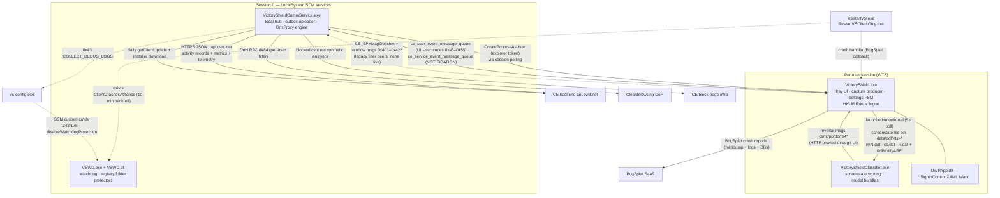

# Victory Shield 10.1.44 — master architecture (synthesis)

This document consolidates the completed subsystem findings into one architecture view of the
Covenant Eyes **Victory Shield 10.1.44** Windows client. It is a synthesis: every claim cites the
findings document that proved it, and mechanism detail stays in those documents. Inference tags
were audited (see `## Inference audit log` at the end); each former tag now carries its verdict
inline — `[VERIFIED: <cite>]`, `[INFERENCE — unresolved: <what is missing>]`, or
`[DEFERRED: classifier-internals pass]`. Non-goals:
no Linux design decisions (that is `re/findings/91-linux-mapping.md`), no re-litigation of findings,
no new RE. Source index: `re/INVENTORY.md` (surface inventory), `re/findings/00-baseline/INDEX.md`
(binary inventory), `01-dynamic-recon/`, `02-artifacts/`, `03-runtime/`, `10-classifier/`,
`12-network/`, `13-service-ipc/`, `14-watchdog/`, `15-ui/`, `16-updater/`.

## 1. System overview

### 1.1 What the product is

Victory Shield is Covenant Eyes' modern Windows accountability client (installed at
`C:\Program Files\CE\`, state under `C:\ProgramData\CovenantEyes\`, uninstall entry
`{5AC5ED2E-2936-4B54-A429-703F9034938E}`). It combines three product features driven by per-user
service flags (`accountability`, `filter`, `screen accountability`, `url accountability`,
`url filtering`, `dns filtering`) delivered by the CE backend
(`re/findings/12-network/filter-surface.md` §1a, `re/INVENTORY.md` §1):

- **Screen Accountability** — periodic full-desktop capture, scored on-device by a bundled ML
  classifier (`re/findings/10-classifier/capture-pipeline.md`).
- **Web/DNS accountability** — every DNS resolution is logged with the querying process and its
  verdict, and uploaded as web-activity records (`re/findings/12-network/filter-enforcement.md`).
- **Filtering** — resolver-level DNS filtering against a per-user CleanBrowsing DoH endpoint plus
  local domain overrides, with "signed out ⇒ no web access" gating
  (`re/findings/12-network/filter-enforcement.md`, `re/findings/15-ui/signin-and-settings.md` §5).

### 1.2 Trust and privacy model (as implemented)

- **Capture and classification are on-device.** Screenstates are PNG images + a JSON manifest
  passed to the local classifier over file transactions; the classifier runs locally with local model
  blobs (`re/findings/10-classifier/capture-pipeline.md` §2; `re/findings/02-artifacts/enc-data.md`).
- **The comm service — the only network uploader — never uploads images.** Its complete activity
  vocabulary is five record types (`webActivityRecord`, `loginActivityRecord`, `circumventionRecord`,
  `switchUserActivityRecord`, `installActivityRecord`); no screenshot bytes, thumbnails, or scores
  exist in its payloads (`re/findings/16-updater/upload-protocol.md` §6). The only screen-adjacent
  telemetry is counters (`client_screenshot`, `client_pdl_*`).
- **What does leave the machine**: DNS/web activity rows (domain, process, verdict), login/logout
  rows, circumvention events (app + window title), user switches, install reports, and generic
  client metrics — all JSON over HTTPS to `api.cvnt.net` with per-user HTTP Basic credentials
  (`re/findings/16-updater/upload-protocol.md` §3–§5).
- Documented carve-outs to the "activity records only" model: (a) the bundled BugSplat crash
  reporter attaches **all client logs plus the full local SQLite databases** to crash reports sent to
  the BugSplat SaaS (`re/findings/16-updater/crash-reporting.md` §3); (b) the classifier can issue
  templated HTTP requests through the client (`HttpRequestProcessor`) and whether that channel ever
  carries screen-derived metadata server-side is not yet proven
  (`re/findings/16-updater/upload-protocol.md` Open items 7, `re/findings/10-classifier/capture-pipeline.md`
  Open questions 1) — see `## Open items`.

### 1.3 Architecture summary

Victory Shield 10.1.44 is a **pure user-mode** product with two LocalSystem SCM services
(`VictoryShieldCommService.exe` — the machine-local hub: loopback HTTP API, SQLite outbox, upload
client, and the DNS-proxy enforcement engine; `VSWD.exe`/`VSWD.dll` — session watchdog and tamper
protectors), one per-session tray UI (`VictoryShield.exe`, HKLM `Run`) that also owns the screen
capture producer and the settings state machine, and one per-session classifier
(`VictoryShieldClassifier.exe`) that the UI launches and monitors. UI↔service traffic uses two
Boost.Interprocess message queues, a legacy shared-memory policy block (`CE_SPYMapObj`), window
messages and named events; screenstates travel as on-disk file transactions; all remote traffic is
JSON/HTTPS from the comm service to a single backend (`api.cvnt.net`) plus a DoH resolver
(CleanBrowsing) used by the DNS filter. Persistence/anti-tamper is configuration-level: SCM
restart-on-failure, a registry/folder protector loop, install-dir ACLs, and a service DACL that
denies stop to ordinary users — no kernel component at all
(`re/findings/01-dynamic-recon/live-surface.md` §a–d; `re/findings/14-watchdog/`).

## 2. Component map

### 2.1 Binaries

First-party binaries are in `C:\Program Files\CE\` (hashes: `re/samples/MANIFEST.sha256`;
per-binary baselines: `re/findings/00-baseline/`). "Lifecycle" describes how the process enters and
leaves existence.

| Binary | Role | Privilege | Lifecycle |
|---|---|---|---|
| `VictoryShieldCommService.exe` | Machine-local hub: local HTTP API `127.0.0.1:48867`, event-queue listener, SQLite outbox + uploader (the only network client), user-settings cache, DNS-proxy enforcement engine | LocalSystem (SCM service `VictoryShieldCommService`, auto-start) | SCM-started at boot/install (`services.exe` child); SCM recovery RESTART ×3 @1 s; graceful stop via SCM shutdown/custom `0x80` (`re/findings/13-service-ipc/service-ipc.md` §7–8; `re/findings/01-dynamic-recon/live-surface.md` §d) |
| `VSWD.exe` + `VSWD.dll` ("WatchdogServiceLibrary") | Watchdog service: 1 s session polling + client relaunch, Registry Protector (22 values), Folder Protector (install-dir ACL), ARP-entry cleanup | LocalSystem (SCM service `VSWD`, auto-start; `CanStop=false`) | SCM-started at boot/install; stop only via SCM shutdown or custom command 243; SCM recovery RESTART ×3 @1 s (`re/findings/14-watchdog/watchdog.md` §1–4, §10; `re/findings/14-watchdog/protectors.md`) |
| `VictoryShield.exe` | Per-session UI + policy state machine: tray/menu, sign-in (XAML Island), screen-capture producer (`PdlEdi`/`ScreenCaptureLibrary`), settings refresh + `CE_SPYMapObj` publisher, classifier launcher/monitor, BugSplat crash client | Interactive user session | Launched at logon via HKLM `Run` value "Victory Shield"; single-instance mutex `VictoryShieldIsRunning`; relaunched by VSWD if missing; crash → `RestartVSClientOnly.exe` (`re/findings/15-ui/ui-architecture.md`; `re/findings/10-classifier/capture-pipeline.md` §1) |
| `VictoryShieldClassifier.exe` (10.1.1: `CovenantEyesClassifier.exe`) | On-device screenstate scoring: consumes screenstate transactions, runs the model bundles, returns messages over its own transaction folders; owns bundle/pdl-edi state | Interactive user session (same user as UI) | Launched + monitored by `VictoryShield.exe` (`LaunchAndMonitorScreenMonitoring`, `--verbose --cache= --data= --model= --version=`, 5 s relaunch poll); one lifetime log per PID (`re/findings/10-classifier/capture-pipeline.md` §4; `re/findings/02-artifacts/classifier-data.md`) |
| `vs-config.exe` | Admin/config CLI: SCM service ops, settings lens (HKLM `…\Victory Shield`), browser DoH policy management, debug-log collection (`--collect-debug`), silent-upgrade switch, watchdog-protection removal, uninstall/destroy (`VsDestroyer`) | Admin (elevated; also spawned by the service for diagnostics) | Transient, invoked by service (`COLLECT_DEBUG_LOGS` → `vs-config --collect-debug -lvs-config.log`) or by admin tooling (`re/findings/13-service-ipc/service-ipc.md` §2; `re/findings/16-updater/updater.md` §9) |
| `RestartVS.exe` | Full-stack restart helper (services + client); crash-counter writer (`updateCrashStatistics`) | Interactive/admin session | Launched by crash path (`MiniDumper::restartAfterCrash`) or manually; mutex `RestartVSIsRunning` (`re/findings/14-watchdog/watchdog.md` §6) |
| `RestartVSClientOnly.exe` | Client-only restart helper: `--RestartRequestFrom <ver> --PID <pid>`; ≤3 restarts then "contact Member Care" dialog | Interactive session | Launched by the UI's BugSplat callback; shares `RestartVSIsRunning` mutex (`re/findings/14-watchdog/watchdog.md` §7; `re/findings/16-updater/crash-reporting.md` §2) |
| `UWPApp.dll` | XAML `UWPApp.SignInControl` (WinRT) hosted by `CSignInDialog` via Microsoft.Toolkit XamlHost | In-process with UI | Loaded by `VictoryShield.exe` (`re/findings/15-ui/ui-architecture.md` §2) |
| `ProcessPrivileges.dll` | Third-party "Process Privileges" v1.5.7.0 (© Nick Lowe 2009; re-signed by CE) — token-privilege toggles used only for ACL work (`SeTakeOwnership/Backup/RestorePrivilege`) | In-process with VSWD | Assembly ref of `VSWD.exe`; same code compiled in-tree in `VSWD.dll` (`re/findings/14-watchdog/watchdog.md` §12; `re/findings/00-baseline/INDEX.md`) |
| `WinSparkle.dll` (fork), `BugSplat64.dll`/`BugSplatRc64.dll`/`BsSndRpt64.exe`, `zip.exe` | Third-party: auto-update runtime (fork with DSA support), crash reporting + out-of-process sender (`BsSndRpt64.exe`, spawned at upload time), Info-ZIP for crash attachments | In-process / spawned helper | Used by UI and comm service (`re/findings/16-updater/updater.md` §1, §5; `re/findings/16-updater/crash-reporting.md` §3) |

### 2.2 Process/service topology

### 2.3 Pure user-mode verdict

**CE ships no kernel component in 10.1.44.** `C:\Windows\System32\drivers\CEA.sys` is a red
herring: it is the stock Microsoft "Event Aggregation Kernel Mode Library" (`EventAggregation.sys`,
10.0.26100.9444), SHA256-identical to the WinSxS servicing copy, Microsoft catalog-signed, not
registered with the SCM, and unopenable as a device (`\\.\CEA` et al. fail). No `*.sys` exists under
the CE directories; no CE WFP filters/callouts/providers (all 85 callouts are Windows built-ins), no
Winsock LSP/NSP, no minifilter, no firewall rules, no proxy settings, no hosts edits, no CE
certificates in any machine store, no scheduled tasks, no AppInit/IFEO hooks. All monitoring,
filtering and enforcement is user-mode
(`re/findings/01-dynamic-recon/live-surface.md` §a–g; `re/INVENTORY.md` §3, §9). The Edge extension
`jmjflgjpcpepeafmmgdpfkogkghcpiha` found on the recon box is a Microsoft component, unrelated to CE
(`live-surface.md` §g).

## 3. Data-flow narratives

### 3.1 Screen capture → screenstate → classifier → activity records

Producer is **`VictoryShield.exe`**; the classifier is a consumer/processor; the comm service only
carries aggregate counters and account-level records
(`re/findings/10-classifier/capture-pipeline.md`; `re/findings/15-ui/ui-architecture.md` §5).

1. **Schedule.** A periodic task table in `PdlEdi` runs `capture screenstate`
   (`PdlEdi::captureScreenstate`). Cadence is **backend-controlled**: `imageScreenshotInterval_sec` /
   `imageScreenshotIntervalVariance_pct` arrive with `GET /v1/member/sensor/config/pdlEdi` and land in
   the `pdl_info` table; steady-state next-run = uniform in `[(1−v)·I, (1+v)·I]` ms. Fallbacks: 5 s
   retry while the classifier is down or the display/session is off, 40 s when no `pdl_info` row
   exists, 60 s when the task produces no value. **There is no idle detector** — gates are WTS
   session state (logon/unlock on; lock/logoff off), display-on, screensaver-not-running, and
   classifier-alive (`capture-pipeline.md` §1; `re/findings/15-ui/signin-and-settings.md` §4).
   Live-validated over a 57.6-min window in which session 1 stayed WTS-locked throughout: **zero**
   `pdl\` transaction folders and zero classifier-tree events in 1,063,077 captured rows, with the
   gate-false retry visible in the UI's production log at 5.06 s mean over 27 samples — the static
   5 000 ms fallback (`re/findings/03-runtime/api-trace.md` §d; the cadence *under activity* is
   still owed — same doc, Open question 1).
2. **Capture.** All monitors via DXGI Desktop Duplication (`Win32DxgiCapture`), DX9 fallback,
   HDR tone-map per monitor; each monitor encoded as **PNG** (`im<N>.dat`) by WIC. The same pass
   enumerates windows; windows whose OS display-affinity/DWM state marks them capture-restricted are
   *not* skipped: they are logged "Possible circumvention", recorded as a `circumventions` row
   (`interruption_type="windows-screen-recording-not-allowed"`, app + window title) and included in
   the manifest with `doNotScore: true` (`capture-pipeline.md` §2–3;
   `re/findings/12-network/filter-surface.md` §7).
3. **Screenstate transaction (file-based handoff — verdict).** Per capture, the UI writes
   `C:\ProgramData\CovenantEyes\Classifier\<SID>\data\pdl\<timestamp>\` containing `im<N>.dat` (PNG),
   `ss.dat` (JSON manifest, schema `3.0.0`: `$schema`, `urlSafeUsername`, `datetime_created`,
   `local_utc_offset`, `images[{filename,screenRect}]`, `monitors`, `apps[{name,window_title,appRect,doNotScore}]`,
   `clientPayload.device`) and the 0-byte ready marker `rr.dat`, then signals the named event
   `PdlNotifyARE`. It is not shared memory, not the message queues, not HTTP. Failure deletes the
   folder and records `capture_error`/`state_transaction_error` telemetry
   (`capture-pipeline.md` §2). A directory watch (`check PDL folder consistency`) logs
   `Circumvention: PDL transaction file removed|renamed` on tampering.
4. **Launch/supervision of the classifier.** The UI launches
   `VictoryShieldClassifier.exe --verbose --cache=<SID>\cache --data=<SID>\data --model=<install>\data
   --version=…` and re-polls every 5 s (`LaunchAndMonitorScreenMonitoring`);
   `VictoryShield.exe` contains **no** model-file handling — model data is exclusively the
   classifier's (`capture-pipeline.md` §4). The classifier's own logs (10.1.1-era) show the same
   contract, a per-PID lifetime log, a non-fatal "Could not attach to user database SQLite error: 26"
   warning at startup, and `pdl-edi`/`bundleManager` subsystems
   (`re/findings/02-artifacts/classifier-data.md`).
5. **Reverse channel (classifier → client).** The classifier opens no sockets; it drops message
   folders (`cs/ht/pp/dd/re4*.dat`) that the UI's `PdlMessageEngine` dispatches — including
   **templated HTTP requests** (`HttpRequestProcessor`: GET/POST/PUT/DELETE with `CE_BASIC`/`NO_AUTH`
   auth, retries, string substitution) that the client executes on the classifier's behalf and
   answers with `hr.dat` transactions (`capture-pipeline.md` §2). The client also owns bundle
   transport (`version.bundle`, `createBundleUpdateRequestASAP`).
6. **Scoring output → activity records.** What the classifier computes stays local in the captured
   evidence; the comm service's upload vocabulary contains **no** score/screen record — only
   `client_screenshot`/`client_pdl_*` counters plus the five account-level record types
   (`re/findings/16-updater/upload-protocol.md` §5–6). The circumvention producer (step 2) is the one
   capture-side data flow that becomes an uploaded record (`circumventionRecord` → `ce-file.circumventions`
   → `activity_log.json`). How screen-accountability *results* reach the CE backend is the open item
   (`## Open items`, 1).

### 3.2 DNS/URL filtering (backend config → enforcement)

Sources: `re/findings/12-network/filter-surface.md` (state model, UI side),
`re/findings/12-network/filter-enforcement.md` (enforcement engine),
`re/findings/12-network/browser-integration.md` (DoH lockdown).

1. **Provisioning.** The UI fetches `/v2/user/{username}.json` (`CeUserSettings` service flags) and
   `/v2/user/{username}/filter/settings/dns.json` (`GenericDnsFilter`: `over_https_url`,
   `clear_browsing_level`, `ipv4/ipv6_primary/secondary`), plus domain-override lists from
   `/v2/client/filter/settings/domains.json`, and persists them into **`ce-user-file`** tables
   `user_info`, `user_dns_filter`, `global_domain_overrides`, `custom_domain_overrides` (writer:
   `VictoryShield.exe`; the service only ever reads them)
   (`filter-surface.md` §1–3; `filter-enforcement.md` verdict c).
2. **Publication.** Settings are mirrored into the UI-owned shared block `CE_SPYMapObj` (flags at
   `+0x19C has_accountability`, `+0x1A0 has_filtering`, `+0x1A4 can_override`, `+0x1B0 is_panicked`,
   `+0x50AE4 has_screen_accountability`, `+0x50AE8 has_url_accountability`, `+0x50AEC has_dns_filtering`,
   `+0x50AF0 has_url_filtering`, username at `+0x28`) and pushed to the service as
   `USER_SETTINGS_CHANGE` (queue code `0x53`), which rebuilds the service-side `UserSettingsCache`
   (`filter-surface.md` §1d–2; `re/findings/13-service-ipc/service-ipc.md` §2, §4).
3. **Engine.** The comm service statically contains the full **`DnsProxy`** module — the single
   enforcement point of the product. A per-adapter user-mode DNS proxy listens on `127.0.0.2`; a
   `DnsSettingsManager` points managed adapters' DNS at it. Per query it resolves **twice** — once via
   DoH to the per-user CleanBrowsing endpoint (custom Boost.Beast RFC 8484 client, GET `?dns=`,
   pool ≤5, `X-CB-Location` captured as `resolution_datacenter`) and once through the user's own
   resolvers — then applies a per-query decision tree (`DnsProxyRequest::processDnsRequest`, 15-code
   `resolution_type`): custom override → `BlockedCustom` with a synthesized answer CNAME'd to
   `blocked.cvnt.net`; global override → `BlockedGlobal`; CleanBrowsing block marker
   (`cleanbrowsing.rpz.noc.org`) → `BlockedFilter`; SafeSearch → `SafeSearchEnforced`; plus allow,
   unfiltered, outage and timeout/failure codes (`filter-enforcement.md` verdict b, §1–2).
4. **Attribution & record.** At packet arrival the client PID is resolved from the UDP owner table
   (`GetExtendedUdpTable`, source-port match) and the process name via PSAPI; every query is inserted
   into `ce-file.dns_activity` with `status='queued'` for the outbox
   (`filter-enforcement.md` verdict a, §3).
5. **`has_url_filtering` is DNS-level only.** No URL/HTTP content inspection exists anywhere in the
   service; "URL filtering" is domain overrides + the CleanBrowsing category filter selected by
   `user_dns_filter.clear_browsing_level`/`over_https_url` (default
   `https://dns.cleanbrowsing.org/doh/adult-filter`) (`filter-enforcement.md` verdict b).
   (Note: `filter-surface.md` §4 originally inferred "no local resolver in 10.1.44"; that doc carries
   the correction — the 10.1.1-era DnsProxy family **is** the active 10.1.44 engine.)
6. **Lifecycle & gating.** `checkForProxySwitch` counts signed-in filtering users (sentinel `"None"`
   excluded) and activates/deactivates the proxy accordingly. The registry flag `DnsProxyDisable`
   (live value `1`) behaves as a **sticky-on gate with inverted naming**: activation runs only when
   the value is 1, and the user-count-driven teardown is suppressed unless forced
   (`filter-enforcement.md` §5). On the recon VM no port-53/`127.0.0.2` listener was live because no
   user session was signed in (`re/findings/03-runtime/network-capture.md`,
   `re/findings/03-runtime/process-observation.md`); vs-config's writers label the same value
   oppositely, and the cross-check remains open (`## Open items`, 4).
7. **Browsers cannot bypass the filter.** The only live "browser integration" is a DoH lockdown
   policy set (§5.3). Health: per-lookup `client_cleanbrowsing_success/_problem` metrics and a
   `DohLookupStatus` outage machine (test packets → `UnrestrictedOutage` → recovery timer); the UI's
   separate `testDnsBlocking` probe hits `http://covenanteyesfilter.com/healthcheck` for telemetry
   only (`filter-enforcement.md` §7; `filter-surface.md` §6).
8. **Logout = no web access.** The tray flow warns "Signing out will disconnect you from the
   Internet", sends `USER_LOGOUT` (`0x4c`), and the service re-evaluates the proxy switch; with the
   sticky-on gate the proxy keeps listening with zero users (user-count teardown suppressed —
   verified, `deactivateDnsProxy` gate `FUN_14023d8a0`), and what it then answers is now known —
   ⚠ evidence correction: the proxy does **not** fail closed at zero users. Zero-user requests
   take the no-filter-socket branch (`request+0x41e0 == 0`) of `DnsProxyRequest::processDnsRequest`
   `FUN_1402ba390` and are answered **fail-open** with `resolution_type` 2 `UnrestrictedUnFiltered`
   (or 3 `UnrestrictedAlwaysAllowable` when the always-allowable predicate `FUN_14038d2b0` hits),
   served from the user-path resolver answer (the filter endpoint is appended only when
   `+0x41e0 != 0`; the `(user: …, filter: …)` log pairing identifies the `param_3` candidate as the
   user-path one)
   [VERIFIED: `FUN_1402ba390` decompiled this audit; code↔name mapping
   `re/findings/12-network/filter-enforcement.md` verdict-b table — closes
   `filter-enforcement.md` Open question 5]
   (`re/findings/15-ui/signin-and-settings.md` §5; `filter-enforcement.md` §5).

### 3.3 Settings & authentication

Sources: `re/findings/15-ui/signin-and-settings.md`, `re/findings/13-service-ipc/service-ipc.md`,
`re/findings/16-updater/upload-protocol.md` §2.

1. **Sign-in** is a CE-account password login in the XAML `UWPApp.SignInControl` (hosted by
   `CSignInDialog`): the host takes username/password, authenticates via
   `AuthProvidedHttpClient<CeUser>` with HTTP Basic (`CE_BASIC`) against the backend, and maps
   failures to UI text ("Invalid username or password", "This user has no Victory Shield services",
   etc.) (`signin-and-settings.md` §1–3).
2. **Credential storage.** API credentials live in the `api_credentials` SQLite table
   (`user_key`, `user_secret`, `password`, `username`) — not present in the captured `ce-file`, so
   bound to `ce-user-file` by elimination only
   [INFERENCE — unresolved: connector-level binding of `ApiCredentialsSqliteTable` not traced (its
   INSERT/UPDATE helper `FUN_140261670`, decompiled this audit, takes the connector from
   `table+8`, but the construction site was not followed); the classifier-internals pass asserts
   `api_credentials` lives in `ce-user-file`
   (`re/findings/10-classifier/classifier-internals-client.md` §4) but likewise traces no
   connector; lazy table creation — now proved real (`screenshot_telemetry` is a lazily created
   `ce-file` table, `## Open items` 6) — keeps the elimination from closing; last examined
   `FUN_140261670` + `upload-protocol.md` §2] (`upload-protocol.md` §2). The same key/secret pair is what the
   uploader sends as HTTP Basic on all seven REST routes. Login sessions are rows in `ce-file.logins`
   (UI writes via `UserLoginSqliteTable`; the service closes stale rows at startup — `resolve open
   logins`). Cached re-login reads `getLastUserCredsFromDatabase`; a "confirm your password" mode
   reuses the same control (`signin-and-settings.md` §3).
3. **Settings refresh & propagation.** `updateUserSettings` refetches user settings, diffs old vs new,
   and fires side effects only on change: `has_screen_accountability` flips → `handleScreenAccountabilityServiceSwitch`
   ("Configured PDL due to service switch"); `has_dns_filtering`/filter-config changes →
   `handleDnsFilterServiceSwitch` → queue code `0x53 USER_SETTINGS_CHANGE` (observed payload: the
   settings key name, e.g. `kckt0717`) → service rebuilds its cache and re-checks the proxy switch.
   The UI also republishes `CE_SPYMapObj` via `setGlobalUserState` and signals `CredentialsChangedARE`
   (`filter-surface.md` §2; `service-ipc.md` §2, §4, §7).
4. **Session lifecycle.** `WTSRegisterSessionNotification` drives `PdlEdi::setSessionOn` (capture
   gating) and logoff cleanup; "switch user" is a distinct program state writing `ce-file.switch_users`;
   a filter-component check with nobody signed in posts `StartLogin` and opens the sign-in UI
   (`signin-and-settings.md` §4–5; `ui-architecture.md` §4b).
5. **Administrative settings** (debug logging, `DnsProxyDisable`, `DisableSilentUpgrade`,
   per-adapter DNS backups, browser policies) are the domain of `vs-config.exe` operating on
   `HKLM\SOFTWARE\Covenant Eyes\Victory Shield`; the full value catalog is
   `re/findings/16-updater/updater.md` §8–9.

### 3.4 Update flow (WinSparkle fork → `getClientUpdate` → silent upgrade)

Source: `re/findings/16-updater/updater.md`; run-of-show in `re/findings/02-artifacts/logs.md`.

1. The **comm service** hosts the WinSparkle instance (state under
   `HKU\S-1-5-18\…\Victory Shield\WinSparkle`: `CheckForUpdates`/`LastCheckTime`/`UpdateInterval`),
   checking every **86,400 s** with an alternate appcast callback that bypasses XML entirely.
2. The callback (`winsparkle::genericAppcastUpdate`) POSTs **`/v1/desktop_client_update`**
   (`getClientUpdate`: `app_name`, `current_app_version`, `device_platform`, `device_os_version`,
   `branch_name`, `change_set`, `unique_device_id`, `device_cpu_architecture`, `ce_user_names`) and
   parses `payload.recommendation` (`now`/`later`/`none`), `critical`, `app_version`,
   `app_download_link`, `release_notes_page_link`, `download_page_link` — the server decides; the
   client does no local version comparison.
3. **Decision**: `now` → update; `later` → only on a manual check; `none` → nothing. In session 0
   (the service) only `critical` updates install silently; `DisableSilentUpgrade` (written by
   `vs-config disableSilentUpgrade` together with `SilentUpgradeDisabledAt`) suppresses the silent
   path for **1 day**, then expires. Observed: `Returning (1): Update now, 10.1.44 - automatic,
   critical` at 09-21 00:08:51 → silent install 13 min later.
4. **Download trust**: HTTPS + host allowlist (`covenanteyes.com`/`cvnt.net`, exact or dot-suffix).
   The WinSparkle fork supports DSA signature verification but **no DSA key is configured** —
   trust is transport + allowlist only (`updater.md` §2, §5).
5. **Install**: `VictoryShield-installer-<ver>-<branch>-<sha>.exe` runs elevated and silent from
   `%WINDIR%\TEMP\Update-<guid>\`: flush pending uploads → stop watchdog + services (`stopAtAllCosts`,
   60 s) → remove legacy components → stage post-reboot deletes → migrate data to
   `PreviousConfiguration\` → create fresh versioned data dir → re-register services/UI → start
   (`updater.md` §6; `## 7` below).

### 3.5 Watchdog & anti-tamper loop

Sources: `re/findings/14-watchdog/watchdog.md`, `re/findings/14-watchdog/protectors.md`,
`re/findings/01-dynamic-recon/live-surface.md` §d.

1. **SCM layer**: both services auto-start as LocalSystem with `FailureActions` = RESTART ×3 @1 s
   (infinite reset window); that policy is itself one of the protected registry values. Service DACLs
   grant STOP only to SYSTEM/Administrators/Power Users — Authenticated Users get QUERY/START only;
   `VSWD` additionally sets `CanStop=false`.
2. **VSWD session loop** (1 s poll of `WTSEnumerateSessionsExA`): for each interactive session with
   a shell (`explorer.exe`) and no **full-path-matching** `VictoryShield.exe`, relaunch it via
   `CreateProcessAsUser` using explorer's primary token. Suppressed for 10 minutes after a recorded
   client crash (`ClientCrashesAt`/`ClientCrashesSince` in the session user's hive — written by
   `RestartVS*.exe`/installer, cleared by the client on healthy start).
3. **Crash escalation**: the UI's BugSplat callback zips logs + databases, uploads to BugSplat, bumps
   crash counters and launches `RestartVSClientOnly.exe --RestartRequestFrom=<ver> --PID=<pid>`;
   that helper restarts the client up to 3 times, then shows the "contact Member Care" dialog.
   `RestartVS.exe` (services + client) is the full-stack counterpart; both share the
   `RestartVSIsRunning` mutex (`re/findings/16-updater/crash-reporting.md` §2–5).
4. **Tamper repair** (inside VSWD): **Registry Protector** — 22 value-protectors over 4 keys
   (HKLM `Run`/`StartupApproved\Run` "Victory Shield"; `Services\VSWD` and
   `Services\VictoryShieldCommService` incl. `ImagePath`, `ObjectName`, `FailureActions`,
   `DependOnService`, `Security`), each `RegNotifyChangeKeyValue`-watched and rewritten verbatim from
   compiled-in constants after a 1 s debounce ("Anomaly Detected. Repairing […]").
   **Folder Protector** — install dir ACL (Everyone Allow read/execute + **Deny delete/delete-child**,
   inheritance protected, files re-inherited) re-applied by a `FileSystemWatcher` on ACL changes.
   Neither protector deletes foreign files or kills processes (`protectors.md`).
5. **Admin/uninstall path**: SCM custom command **243** = "protections off + graceful stop" (also
   used at shutdown); **176** = hard self-exit(3011); `vs-config disableWatchdogProtection` calls the
   `VSWD.dll` exports `disableFileProtection`/`disableRegistryProtection`; at every service start
   VSWD deletes the ARP entry's `WindowsInstaller`/`ModifyPath` values so the MSI cannot repair/modify
   the install (`watchdog.md` §10–12).

### 3.6 Telemetry heartbeat & metrics upload cycle

Sources: `re/findings/16-updater/upload-protocol.md` §4–5 (tick/outbox mechanism),
`re/findings/03-runtime/network-capture.md` (601 s heartbeat, zero-packet tick, "frozen"
`LastTelemetryUploadAt`); live-traced with per-PID attribution over a 57.6-min window on
2026-09-27 (`re/findings/03-runtime/api-trace.md` §b–e).

1. **The ~601 s tick is the comm service's local bookkeeping pass (PID 5616).** Measured
   600.90–600.98 s across five consecutive in-window intervals; each tick queries the
   metrics/crash inputs (`SqlErrors`, `ServiceCrashes`, `ForceCrashCommService`), runs
   `RegFlushKey` on the service key, stamps `LastTelemetryUpdateAt`, and — [INFERENCE —
   unresolved: the trigger for the `ce-file` scan; the single observed full scan (5,593 `ReadFile`
   inside one 2 s tick window at 09:47:55, absent at later ticks) coincided with the 09:43–09:53
   API-activity burst, but later ticks read zero `ce-file` pages while metrics rows stayed unsent
   until 10:23, so "only when rows are pending" is not established; last examined `api-trace.md`
   §b + `re/samples/runtime/api-trace-b-registry-tick.csv`] — scans `ce-file`, with
   **zero network events at the tick instant**. The UI (128096) runs
   a second, independent 601 s writer for its own `HKCU\…\ClientCrashesSince = 0`
   (601.07–601.14 s) (`api-trace.md` §b; corroborates `network-capture.md`'s zero-packet tick
   with per-PID data).
2. **Upload is a separate event from the tick — the "frozen" `LastTelemetryUploadAt` resolved.**
   The value moves only on a real upload: at **10:23:34** (2026-09-27) the comm service opened a
   fresh TLS connection and wrote `ApiTelemetryStatus=success`, `ApiTelemetryResumeTime=(empty)`
   and `LastTelemetryUploadAt=2026-09-27T15:23:34.289 UTC`, clustered with a 39-row `ce-file`
   burst (metrics rows → `sent`) — the first upload since 2026-09-20, so `network-capture.md`'s
   window simply never contained one (`api-trace.md` §b; closes `network-capture.md`
   Open question 6).
3. **Backend connections rotate activity-driven, ~301 s per exchange generation.** During upload
   bursts the comm service dials `208.185.195.49:443` fresh every 301 s
   (09:43:31 → 09:48:32 → 09:53:33), disconnecting the idle predecessor and preceded ~75–250 ms
   earlier by a same-PID loopback self-connect pair (9 B send → 1 B reply), then 30 min of
   silence resumed only around the next upload — an activity-cycle period, not a global
   keep-alive and not tick-driven (`api-trace.md` §c and Open questions 3, 5; closes
   `network-capture.md` Open question 1).
4. **`ce-file` has two live writers.** Every write burst attributes by PID to a cause — comm
   service 5616: tick bookkeeping, metric inserts at API success (`created_at` exact to the
   second, e.g. 09:43:39/09:48:40), the upload's `sent` transitions (10:23); UI 128096: its own
   metric rows on a ~15-min HTTP cycle (09:37/09:52/10:07/10:22) and a backend TLS burst at
   10:20 (`api-trace.md` §e, §c).

## 4. State & storage

All paths under `C:\ProgramData\CovenantEyes\` unless noted. The per-install directory name encodes
the version (`VictoryShieldv010.001.044\`, previously `WindowsClientv010.001.001\`); the upgrade
preserves the prior `ce-user-file` in `PreviousConfiguration\`
(`re/findings/02-artifacts/logs.md`, `re/findings/02-artifacts/user-file.md`).

| Store | Where | Format | Writers | Readers | Notes / source |
|---|---|---|---|---|---|
| `ce-file` | `VictoryShieldv010.001.044\ce-file` | Plaintext SQLite 3 (WAL, 4 KiB pages) | Comm service (all outbox INSERTs/UPDATEs); UI (`logins`) | Comm service uploader + local dashboard | Tables `install_metadata`, `logins`, `metrics`, `circumventions`, `switch_users`, `dns_activity` with `(status, status_changed_at, created_at)` outbox triple and `(username, status, …)` indexes — `re/findings/02-artifacts/local-db.md` |
| `ce-user-file` | same dir (prev. copy in `PreviousConfiguration\`) | **SQLCipher 4** SQLite (AES-256-CBC + HMAC-SHA512 page MAC + PBKDF2-HMAC-SHA512; 4 KiB pages) | **UI** (`UserDnsFilterSqliteTable::set`, `UserInfoSqliteTable::set`); service performs schema migrations only | Service (settings cache, DNS filter config, credentials); classifier ATTACHes this container as `userdb` at startup (non-fatal SQLite error 26) [VERIFIED: `ce-user-file` literal + `CREATE TABLE IF NOT EXISTS userdb.telemetry …` + `Could not attach to user database (c)/(t)` strings in `VictoryShieldClassifier.exe` (this audit); `re/findings/10-classifier/classifier-internals-classifier.md` Logging taxonomy] | Hardcoded passphrase `AN0ther$uper$ecretKEY4This` (XOR keystream `83 ad c3 4b 1a 47 d6 f8`) — `re/findings/13-service-ipc/service-ipc.md` §5; container stats `re/findings/02-artifacts/user-file.md`. Tables incl. `user_info`, `user_dns_filter`, `global_domain_overrides`, `custom_domain_overrides`; `api_credentials`, `pdl_info`, `user_login` are [INFERENCE — unresolved: elimination-only same-container bindings (each process opens exactly two DBs; tables absent from the complete captured `ce-file` schema); connector-level bindings not traced; last examined `FUN_140261670`/`FUN_140268ba0` decompiles this audit] (`service-ipc.md` §4, `upload-protocol.md` §2); `telemetry` (the classifier's key/value `userdb.telemetry`) is verified in this container; ⚠ evidence correction: `screenshot_telemetry` is a **`ce-file`** table, not this container (store ctor `FUN_14013f840` opens `ce-file` — `re/findings/10-classifier/classifier-internals-client.md` §3; created lazily, hence absent from the captured `ce-file` schema) |
| `ce_user_event_message_queue` | same dir | Fixed-slot mapped file: 256 B superblock + 10 × (8 B length + 256 B payload) | UI (send), comm service (recv + startup `QUIT/IgnoreMe` priming) | Comm service listener | Wire = 1 code byte + payload — `re/findings/02-artifacts/event-queue.md`, `re/findings/13-service-ipc/service-ipc.md` §2 |
| `ce_service_event_message_queue` | same dir | Same shape, 10 × 512 B slots | Comm service (`sendClientNotification`) | UI (`ServiceEventMessageQueueListener`) | Code 2 = `NOTIFICATION`, 2×6×100 ms retries — `service-ipc.md` §2 |
| `CE_SPYMapObj` (+ `CE_SPYMutexObj`) | named file mapping, 0x50AF8 B | Binary shared-memory policy block | UI (`OnCreate` creates; `setGlobalUserState` writes flags/username) | Legacy filter peers via window messages `0x401–0x407`/`0x428` + `ceFilterCheckReply%d` slots (none live in 10.1.44) | Offsets in `## 3.2`; `re/findings/15-ui/ui-architecture.md` §4b. The comm service never touches it (`service-ipc.md` §6) |
| Classifier per-SID tree | `Classifier\<SID>\` (`cache\`, `data\`) + `Classifier\logs\<pid>.txt` | Small binary blobs + transaction folders | UI (pdl transactions), classifier (client transactions, `cache\bmdat\nxu.dat`, `ht.dat`, `su.dat`) | Classifier; UI (reverse messages) | `data\pdl\<ts>\{im<N>.dat, ss.dat, rr.dat[, su.dat]}`, `data\client\<epoch-ms>\{ht.dat, re4*.dat}`, `cache\bmdat\nxu.dat` (32 B "nextUpdate" marker) — `re/findings/02-artifacts/classifier-data.md`, `capture-pipeline.md` §2 |
| Model blobs | `C:\Program Files\CE\data\*.dat.enc` (6 files, ~8 MB) | Encrypted blobs, sizes %16==0, entropy ≥7.99; names `<20hex>-<role>.dat.enc`, role ∈ {b1,b2,b3,j1,mn,sw} | Installer (destroys + re-ships whole dir on upgrade) | Classifier only (`--model=`) | b1/b2/b3 share a 9,584-byte identical prefix (same-size shards); j1/mn content ids changed across 10.1.1→10.1.44 — `re/findings/02-artifacts/enc-data.md` |
| Registry `HKLM\SOFTWARE\Covenant Eyes\Victory Shield` | machine hive | Values (`InstallMode`, `DnsProxyDisable`, `FirstRunDone`, `EnableDebugLogging`, `DisableSilentUpgrade`/`SilentUpgradeDisabledAt`, `LastTelemetryUpdateAt/UploadAt`, `ApiTelemetryStatus/ResumeTime`, `NetworkStatus\{adapter}`, `NetworkInterfaces\…`) | Installer, comm service, vs-config, UI | all components | Catalog: `re/findings/16-updater/updater.md` §8–9 |
| Registry per-user `HKCU\<SID>\SOFTWARE\Covenant Eyes\Victory Shield` | user hives | `ClientCrashesAt`/`ClientCrashesSince`, `CommServiceCrashes*`, `auto log`, WinSparkle state | `RestartVS*.exe`/installer (counters), UI (clear on healthy start), WinSparkle | VSWD (crash back-off), updater | `re/findings/14-watchdog/watchdog.md` §5; `re/findings/16-updater/crash-reporting.md` §5 |
| Logs | `VictoryShieldv010.001.044\logs\comm-service\major-<pid>.log`, `Classifier\logs\<pid>.txt`, installer logs, `ThirdParty\logs\proxy\` | Text (boost-log `SEV|ts|tid|tag|msg`) | each component | support diagnostics, BugSplat attachments | Cadences/vocabulary: `re/findings/02-artifacts/logs.md` |

**Outbox state machine** (uniform across event tables): rows are inserted `queued` (metrics first
accumulate as `collecting` in open 1-hour buckets), claimed `queued → sending` with a minimum-age
gate and batch size 100, marked `sent` on server ack, and stale `sending` rows are requeued for crash
recovery (`re/findings/13-service-ipc/service-ipc.md` §4; `re/findings/16-updater/upload-protocol.md` §4).

## 5. Interfaces

### 5.1 Local IPC

Four coexisting channels (`re/findings/13-service-ipc/service-ipc.md`; `re/findings/15-ui/ui-architecture.md` §4):

**a) Boost.Interprocess message queues** (mapped files; wire = 1 code byte + payload):

| Code | Name | Direction | Effect at the service |
|---|---|---|---|
| `0x43` | `COLLECT_DEBUG_LOGS` | UI → service | Notifies UI, launches `vs-config.exe --collect-debug`, notifies on finish |
| `0x4c` | `USER_LOGOUT` | UI → service | Schedules `checkForProxySwitch` (filter state re-evaluation) |
| `0x4d` | `SEND_METRICS` | UI → service | Immediate metrics outbox flush |
| `0x51` | `QUIT` | UI ↔ service | Session-guarded shutdown ("Ignoring quit message belonging to previous session"); service also self-sends `QUIT/IgnoreMe` at startup to reset stale listeners |
| `0x52` | `SET_WINDOWS_REGISTRY` | UI → service | Applies a serialized registry-change request |
| `0x53` | `USER_SETTINGS_CHANGE` | UI → service | Rebuilds `UserSettingsCache` from the DBs; then proxy-switch check |
| `0x54` | `SEND_TELEMETRY` | UI → service | Immediate telemetry flush |
| `0x55` | `UNKNOWN` | — | Empty-poll sentinel / no-op |
| `2` | `NOTIFICATION` | service → UI | Human-readable notification text (back-channel `ce_service_event_message_queue`) |

**b) HTTP on `127.0.0.1:48867`** — cpp-netlib server, complete route table, **no authentication on
any route** (`service-ipc.md` §1):

| Method | Path | Purpose |
|---|---|---|
| GET | `/` | Dashboard (HTML assembled from embedded templates, `/static/local.css` from a resource) |
| GET | `/about` | About page |
| GET | `/antivirus` | AV/firewall status (WMI `root\SecurityCenter2`) |
| GET, POST | `/settings/user/:user-id:` | "Advanced Configuration" checkboxes (debug logging, tray, splash…); POST saves |
| GET | `/settings/dns/:id:` | "Managed DNS Settings" page |
| GET | `/logs/` | "Your DNS activity on this computer" (last 500 `dns_activity` rows) |
| GET | `/internal/status/:username:` | Client status stats |
| GET | `/internal/command/:command:` | `requeue` (requeue failed sends) / `test-api-connectivity` |
| GET | `/local/user/:username:/keys.:doctype:` | Returns a `basicAuthentication` key/secret JSON body (hard-coded sample) |
| GET | `/static/:resource:` | `local.css` only |
| any | (fallback) | 404 |

**Live-duty note:** the listener is served but **never used** on its own — across 57.6 min of
live capture (2026-09-27, locked-idle session) with the UI, service, watchdog and classifier all
running, 424 netstat samples showed only the `LISTENING` row and **zero** of 259 Procmon network
events involved port 48867 (`re/findings/03-runtime/api-trace.md` §c): the dashboard and every
route above stay dormant unless something actively drives them. This extends
`re/findings/03-runtime/network-capture.md`'s zero-client windows — captured when the UI was not
even running — to a session where the expected clients existed.

**c) `CE_SPYMapObj` shared memory + window messages** — UI-owned policy block (flag offsets in
§3.2) with per-request reply slots `ceFilterCheckReply%d` and messages `0x401` (`OnSpyHookAPI`, dead),
`0x403` (`OnEndSessionCustom`), `0x405` (`OnForceLogout`), `0x406` (`OnFilterCheck` → opens sign-in),
`0x428` (stub), plus forwarders `0x432–0x438` (e.g. `0x435` → `createBundleUpdateRequestASAP`).
Message map fully enumerated in `re/findings/12-network/filter-surface.md` §6.

**d) Named events + file transactions** — `PdlNotifyARE` (screenstate ready), `ClientNotifyARE`/
`ClientNotifyProcARE` (classifier↔client), `CredentialsChangedARE`, `ClassifierIsRunning`; the
screenstate/reverse-message file protocol of §3.1 (`capture-pipeline.md` §2).

### 5.2 Backend REST catalog

Base `https://api.cvnt.net` (live: `208.185.195.49:443`, cluster `slc_1b`), static libcurl
(OpenSSL + schannel backends), HTTP Basic from `api_credentials` (user key/secret), **no certificate
pinning**. Every call is wrapped by a tracking client recording `client_api_success`/`client_api_problem`
metrics; server-requested throttling persists in `ApiTelemetryStatus`/`ApiTelemetryResumeTime`
(`re/findings/16-updater/upload-protocol.md` §1–4; `re/findings/03-runtime/network-capture.md`).

| Route | Method | Purpose | Trigger |
|---|---|---|---|
| `/v1/status/time` | GET [INFERENCE — unresolved: HTTP method; traced this audit from the URI factory `FUN_140205ca0` through the `Uri` ctor `FUN_1401d8a80` (scheme default `http` `0x1409a74d4`, no verb field) and `AuthProvidedHttpClient::communicate` `FUN_14022ef50` (virtual dispatch into the libcurl layer); no `GET`/`POST` literal exists in the binary — defined-string regex `^(GET\|POST\|PUT\|HEAD)$` is empty; tracker `re/findings/16-updater/upload-protocol.md` Open question 3] | Server clock sync → `(server time, local ticks)` baseline | Hourly (`ServerTimeManager::sync`, median 3,600.7 s) |
| `/v1/status/ping` | GET [INFERENCE — unresolved: method, same trace as the `/v1/status/time` row] | API reachability pre-flight | callback-registered |
| `/v2/user/{username}/report/activity_log.json` | POST | **The accountability upload**: batched `webActivityRecord`/`loginActivityRecord`/`circumventionRecord`/`switchUserActivityRecord`/`installActivityRecord` with `client{arch,platform,platformVersion,version}` envelope | `ApiActivityLoggingThread`, batch 100, per-user |
| `/v1/metrics` | POST | `metrics` rollups (1-hour buckets, indexed/cardinal/incidental tags) | timer + `SEND_METRICS` |
| `/v1/logs/store` | POST | API request/response event-log rows | periodic |
| `/v1/telemetry/store` | POST | Device/telemetry counters (`telemetry` table) | timer + `SEND_TELEMETRY` |
| `/v1/desktop_client_update` | POST [INFERENCE — unresolved: method of the comm-service's own WinSparkle-path call; same trace as the `/v1/status/time` row. (The classifier's `ht.dat` template for this same URL is proven POST/`NO_AUTH` — `re/findings/10-classifier/classifier-internals-classifier.md` §C-2 — but that is a different caller)] | `getClientUpdate` update recommendation (`recommendation` now/later/none, `critical`, links) | daily (86,400 s) WinSparkle check |
| `/v2/user/{username}.json` | GET | `CeUserSettings` service flags (`services.accountability/filter/screen accountability/url accountability/url filtering/dns filtering`) | sign-in / settings refresh (UI) |
| `/v2/user/{username}/filter/settings/dns.json` | GET | `GenericDnsFilter` (DoH URL, level, fallback resolvers) | settings refresh / migration (UI) |
| `/v2/client/filter/settings/domains.json` | GET | Global/custom domain-override lists | settings refresh (UI) |
| `/v1/member/sensor/config/pdlEdi` | GET | Capture cadence config (`imageScreenshotInterval_sec`, `_variance_pct`, `pdlVersion`, `pdlData`) → `pdl_info` | capture scheduler (UI) |

Adjacent non-API hosts: `blocked.cvnt.net` (synthetic block answers' CNAME), the CleanBrowsing DoH
endpoint (`https://dns.cleanbrowsing.org/doh/adult-filter` default), `covenanteyes.com` appcast +
installer downloads, `covenanteyesfilter.com/healthcheck` (UI probe), BugSplat SaaS
(`https://www.bugsplat.com`, `database=covenant-eyes-10-1`) —
`upload-protocol.md` §3, `re/findings/16-updater/crash-reporting.md` §3,
`filter-enforcement.md` §7. On the idle recon box, all observed CE egress was `api.cvnt.net` alone
(`re/findings/03-runtime/network-capture.md`).

### 5.3 Browser surface

10.1.44 ships **no live browser extension**. Firefox (`firefox-integrated-extension@covenanteyes.com`),
Chrome (`bfegkegffcbgpfmemahhkgnbkocmbain` force-install/external-extension keys) and IE BHO
(`{927BD2E1-2287-49D2-AE71-95F492CE662E}`, `ceie` DLLs) exist only in `vs-config`'s **removal** code
(`VsDestroyer`/`BrowserExtensions.cpp`) and installer cleanup; the active browser integration is a
**DoH lockdown policy set** written by `ce::sys::disableBrowserSecureDns`
(`re/findings/12-network/browser-integration.md`; `re/findings/16-updater/updater.md` §9c):

| Value | Key | Written as | Purpose |
|---|---|---|---|
| `BuiltInDnsClientEnabled` | `HKLM\SOFTWARE\Policies\Microsoft\Edge\` | `0` | disable Edge's built-in resolver |
| `DnsOverHttpsMode` | `…\Edge\`, `…\Google\Chrome\`, `…\BraveSoftware\Brave\` | `off` | force browsers off DoH so the DNS filter cannot be bypassed |
| `TorDisabled` | `…\BraveSoftware\Brave\` | `1` | anti-circumvention |
| `Locked` / `Enabled` | `…\Mozilla\Firefox\DNSOverHTTPS\` | `1` / `0` | policy-lock Firefox DoH off |

Browsers are force-closed at install/upgrade; `VictoryShield.exe`/`UWPApp.dll` contain zero
extension strings and open all web surfaces (dashboard, activity report, support pages) in the
default browser via `ShellExecuteW` (`browser-integration.md` §2–4; `ui-architecture.md` §3).

## 6. Security posture (objective RE findings)

1. **Unauthenticated local API exposing API material.** Every route on `127.0.0.1:48867` is
   unauthenticated (the only 401 is "can't resolve the logged-in Windows user"); any local process can
   read DNS activity, read/write the computer's settings (`POST /settings/user/…`), trigger internal
   commands, and fetch `/local/user/:u:/keys.:doctype:` which returns a `basicAuthentication`
   key/secret body with no check (`re/findings/13-service-ipc/service-ipc.md` §1).
2. **Hardcoded SQLCipher passphrase.** `ce-user-file`'s key is the constant
   `AN0ther$uper$ecretKEY4This`, embedded XOR-obfuscated (keystream `83 ad c3 4b 1a 47 d6 f8`) —
   the encryption-at-rest protects against offline file theft only by obscurity
   (`service-ipc.md` §5). Meanwhile `ce-file` (all accountability events) is **plaintext** SQLite
   (`re/findings/02-artifacts/local-db.md`).
3. **No certificate pinning; unauthenticated package trust.** Backend TLS uses default CA-chain
   validation (curl's pinning machinery present but unused); the update pipeline trusts downloads by
   HTTPS + domain allowlist only — the WinSparkle fork's DSA signature support ships **unconfigured**
   (`re/findings/16-updater/upload-protocol.md` §1; `updater.md` §5).
4. **Credentials hygiene.** `api_credentials` stores `user_key`, `user_secret` **and a `password`
   column** locally; auth is HTTP Basic over TLS; there is no logout/revoke endpoint — logout is a
   local-only state change (`upload-protocol.md` §2).
5. **Dead break-glass: the "Filter guardian" dialog.** Resource #215 ships ("technical issues with
   the filter… enter your filter guardian username and password to continue with an unfiltered
   connection") but no code constructs it (resource ID, controls and message map exhaustively
   negative). With the sticky-on `DnsProxyDisable` gate the product is fail-closed with no working
   local override path (`re/findings/12-network/filter-surface.md` §6; `filter-enforcement.md` §5).
6. **Anti-tamper is configuration-level and modest.** Install-dir ACL Everyone deny-delete + RX with
   a FileSystemWatcher re-lock; 22 registry value-protectors (autostart + both service keys incl.
   `ImagePath`/`FailureActions`/`Security`) restored verbatim with a 1 s debounce; ARP `ModifyPath`
   deletion prevents MSI repair. No process guarding: VSWD never kills foreign processes, and its own
   resilience rests on `CanStop=false`, the service DACL and SCM recovery
   (`re/findings/14-watchdog/protectors.md`; `watchdog.md` §12).
7. **Service SDDL.** Identical DACL for both services: SYSTEM + Administrators full, Power Users
   start/stop (legacy group), Authenticated Users/SERVICE/INTERACTIVE query-class + START but **no
   STOP, no CHANGE_CONFIG**; audit SACL on Everyone. Ordinary users can start but not stop or
   reconfigure the services (`re/findings/01-dynamic-recon/live-surface.md` §d).
8. **Third-party privilege library.** `ProcessPrivileges.dll` is unmodified third-party code
   ("Process Privileges" v1.5.7.0, © Nick Lowe 2009, CodePlex-era) re-signed by CE; used only for
   `SeTakeOwnershipPrivilege`/`SeBackupPrivilege`/`SeRestorePrivilege` toggles during ACL work
   (`re/findings/14-watchdog/watchdog.md` §12; `re/findings/00-baseline/INDEX.md`).
9. **Crash reports carry the activity databases.** The BugSplat callback attaches `debugLogs.zip`,
   `debugClassLogs.zip` and `debugDB.zip` (the full `ce-file`/`ce-user-file` + WAL/SHM) up to 5 MB per
   file / 19 MB total to the BugSplat SaaS — a periodic leak of the entire local accountability record
   set outside the documented activity-record channel
   (`re/findings/16-updater/crash-reporting.md` §3).
10. **Production build retains test/kill hooks**: `crashatonce=true` cmdline self-crash,
    `ForceCrashClient`/`ForceCrashCommService` settings, SCM custom "fail" command 176
    (VSWD `Environment.Exit(3011)`, comm service `0xb0`), QA override file for `getClientUpdate`, and
    the support diagnostics dialog ("Upload Batch Now", "Score Now", "HTTP Client Tracing")
    (`crash-reporting.md` §4; `watchdog.md` §10; `updater.md` §2; `ui-architecture.md` §1).
11. **Configuration foot-gun.** `DnsProxyDisable`'s name is inverted relative to its operative
    semantics (sticky-on gate) and `vs-config`'s `disableDnsProxy`/`enableDnsProxy` labels disagree
    with the enforcement code — see `## Open items`, 4
    (`filter-enforcement.md` §5; `updater.md` §9a).

## 7. Version lineage: 10.1.1 → 10.1.44

The recon VM was upgraded in place on 2026-09-21 (`InstallMode=upgrade`); the full run-of-show is in
`re/findings/16-updater/updater.md` §6 and the component inventory in
`re/findings/02-artifacts/logs.md` ("Installer logs").

| Aspect | 10.1.1 ("WindowsClient") | 10.1.44 ("Victory Shield") | Source |
|---|---|---|---|
| UI binary | `CovenantEyes.exe` | `VictoryShield.exe` (renamed; Run value rewritten) | `logs.md` |
| Comm service | `CovenantEyesCommService.exe` / service `CovenantEyesCommService` | `VictoryShieldCommService.exe` / service `VictoryShieldCommService` (same 8 deps) | `logs.md` |
| Watchdog | `CEWD.exe` / service `CEWD` | `VSWD.exe`+`VSWD.dll` / service `VSWD` | `logs.md` |
| Classifier | `CovenantEyesClassifier.exe` (`--version=10.1.1`) | `VictoryShieldClassifier.exe` (same CLI contract [VERIFIED: the shipped 10.1.44 binary parses `--model/--data/--cache/--version` (+ `--verbose`) cxxopts-style at `FUN_14184ff40`, with the exact flag-name log strings (`PDL-EDI data folder path:` etc.) — `re/findings/10-classifier/classifier-internals-classifier.md` "CLI contract"]; upgrade kills both names) | `re/findings/02-artifacts/classifier-data.md` |
| Network stack | Winsock NSP `nmNsp.dll` + LSP `nmSvc.dll`/`nmsvTree.dll` ("LSP Index binary" values), legacy `CovenantEyesProxy.exe` (Redirector V3.0.0.48) proxy/cert/COM, IE BHO `ceie`, Firefox extension, Chrome force-install | **All removed** — NSP uninstall (`WSCUnInstallNameSpace`, error 10022 = no-op on clean systems), `LSP_UnInstalling`, proxy `/UnregServer` cleanup, browser-extension removal code; only DoH lockdown remains | `logs.md`; `re/findings/12-network/browser-integration.md`; `re/findings/01-dynamic-recon/live-surface.md` §c, §f |
| Data dirs | `ProgramData\CovenantEyes\WindowsClientv010.001.001\` | `…\VictoryShieldv010.001.044\` freshly created (`createDatabaseFiles`); old `ce-user-file` copied to `PreviousConfiguration\`; version-encoded dir names enable side-by-side rollback | `logs.md`; `user-file.md` |
| Settings migration | per-user legacy key `…\SOFTWARE\Covenant Eyes\kckt0717` (`LSP Index binary`, `Time binary`, …) | key deleted as legacy; `InstallMode=upgrade` kept; `DnsProxyDisable=1` written; `DisableSilentUpgrade`/`SilentUpgradeDisabledAt` removed; telemetry values re-stamped | `logs.md`; `updater.md` §8 |
| Model blobs | `data\{83b5…-b1, d8b8…-b2, 805b…-b3, a076…-sw, b933…-j1, 436a…-mn}.dat.enc` | b1/b2/b3/sw **names byte-identical** (payloads unchanged), j1/mn get new content-id prefixes — installer destroys and re-ships the whole `data\` dir | `re/findings/02-artifacts/enc-data.md` |
| Filtering engine | DnsProxy on `127.0.0.2` with `fec0:0:0:ffff::1-3` "DNS User" upstreams, 60 s DNS-server-removal loop (visible in 10.1.1 logs) | Same `DnsProxy` family statically inside the comm service (127.0.0.2, CleanBrowsing DoH, per-user ref-counted activation); `fec0` residue is dead 10.1.1 config, zero references in 10.1.44 | `filter-enforcement.md` §5–6; `logs.md` |
| UI stack | legacy AdaptiveUI / helper binaries (`CovenantEyesAdaptiveUI.exe`, `CovenantEyesHelper.exe` removed) | MFC tray + XAML Island sign-in (`UWPApp.dll`, `.xbf` blobs); WinSparkle fork + BugSplat crash chain | `logs.md`; `re/findings/15-ui/ui-architecture.md` |

The upgrade sequence itself (elevated, `Install mode: silent`): flush UI uploads via window messages →
stop watchdog/services (`stopAtAllCosts`, 60 s) → legacy proxy/NSP/LSP teardown → staged
post-reboot deletes → data migration → fresh DBs → re-register services (deps logged) → start;
no reboot required in the observed run (`updater.md` §6–7).

## Open items

Exact-scope list of what the findings leave open. Items 1–3 are the pending classifier-internals pass
(`VictoryShieldClassifier.exe`); the rest are cross-cutting residues with their owning doc named.

1. **Classifier screenstate consumption & scoring.** Confirm the `rr.dat`-ready watch on
   `data\pdl\`, the read/interpretation of `ss.dat` + `im<N>.dat`, handling of `doNotScore` windows
   and `apps[]` rects, and the response file types (`re4*.dat`? `ht.dat`?) and their semantics —
   how scores are delivered to the client/UI and onward. Scope: `VictoryShieldClassifier.exe` + the
   `PdlMessageEngine` counterparts (`re/findings/10-classifier/capture-pipeline.md` Open questions 1, 4).
2. **Model/blob formats & keying.** Contents of the six `*.dat.enc` roles (`b1/b2/b3` shards, `sw`,
   `j1`, `mn`), the decryption/loading path behind `--model=`, and the `bundleManager`/`pdl-edi`
   bundle format (`nxu.dat` nextUpdate semantics, `bmdat` cache, `ht.dat` hash tables, `su.dat`,
   `data\client\<epoch-ms>` naming). Scope: classifier binary + the encrypted blobs
   (`re/findings/02-artifacts/enc-data.md`, `classifier-data.md`; `capture-pipeline.md` Open questions 2, 4).
3. **Classifier-side delivery & experiments.** Whether the classifier's templated HTTP channel
   (`HttpRequestProcessor` proxied through the UI) uploads screen-derived metadata/scores to CE
   servers — the last unresolved leg of the "screen accountability" pipeline, since the comm service
   provably uploads no image/score records; plus `pdl-edi` "Experimental chance" semantics and the
   production values of `imageScreenshotInterval_sec/_pct` from `/v1/member/sensor/config/pdlEdi`.
   (`re/findings/16-updater/upload-protocol.md` Open items 7; `capture-pipeline.md` Open questions 3, 5.)
4. **`DnsProxyDisable` semantics cross-check.** The enforcement code reads value `1` as "proxy may
   run and user-count teardown is suppressed" (sticky-on) while `vs-config`'s
   `disableDnsProxy`(→1)/`enableDnsProxy`(→0) labels say the opposite; confirm the intended contract
   before treating either as normative. ⚠ evidence correction on the second half of this item: the
   fail-closed claim is **contradicted** — what the proxy answers with zero signed-in users is now
   verified fail-open (`resolution_type` 2/3, user-path answer; see §3.2 item 8)
   [VERIFIED: `FUN_1402ba390` decompiled this audit]
   (`re/findings/12-network/filter-enforcement.md` Open question 2; its Open question 5 is closed
   by this audit).
5. **`DnsProxy::updateServerLists` internals** — exact mapping of `user_dns_filter` fallback resolvers
   vs adapter resolvers into the "DNS Filter"/"DNS User" lists, when DoH is preferred over plain UDP,
   the RFC 8484 payload encoder (GET+base64url [VERIFIED this audit: the encoder is `FUN_14038e320`,
   using the URL-safe alphabet `A–Za–z0-9-_`; `DnsProxySocket::sendDohRequest` `FUN_1402d7f50`
   concatenates its output after the `"?dns="` literal `0x1409b9db8` and truncates the encoder's
   emitted `.`-padding at the first `.`, i.e. unpadded base64url per RFC 8484 §4.1.1;
   `DnsHttpClient::async_request` `FUN_1402da150` carries only (host, port, target) — no verb
   parameter — for a query-string-only target; closes `filter-enforcement.md` Open question 4]), and
   the live cadences of
   `checkForProxySwitch`/outage timers/`enforce DNS settings`
   (`filter-enforcement.md` Open questions 1, 3).
6. **`ce-user-file` table/DB bindings.** `api_credentials`, `pdl_info`, `user_login` and the
   request/response trace table are [INFERENCE — unresolved: connector-level bindings not traced;
   last examined `FUN_140261670` + `re/findings/13-service-ipc/service-ipc.md` §5 (which itself
   leaves the two store connectors' identity inferred) + `re/findings/16-updater/upload-protocol.md`
   Open items 1]; ⚠ evidence correction on two of the tables this item listed: `screenshot_telemetry`
   is **not** in the encrypted container — it is a `ce-file` table, proved by the classifier-internals
   pass (store ctor `FUN_14013f840` opens `ce-file`; SQL wrappers `FUN_14014c0f0`/`FUN_14014c3c0`/
   `FUN_14014c620`; the same `view+0x3a8` connector feeds the metrics recorder —
   `re/findings/10-classifier/classifier-internals-client.md` §3, which closes this question for that
   table); and `telemetry` is now positively indicated in `ce-user-file` (the classifier ATTACHes
   that container as `userdb` and ensures `userdb.telemetry` —
   `re/findings/10-classifier/classifier-internals-classifier.md` Logging taxonomy), though the
   comm-service `TelemetrySqliteTable` connector remains untraced; also the exact SQLCipher open
   sequence and any non-default settings
   (`re/findings/13-service-ipc/service-ipc.md` Open questions 3, 5, 7;
   `re/findings/16-updater/upload-protocol.md` Open items 1).
7. **Local IPC residues.** Fixed-slot queue record format while idle (length word semantics, ring vs
   append-log, `qword@0x00=2`/`qword@0x08=88` meaning) — `re/findings/02-artifacts/event-queue.md`
   Open questions 1–6; who posts `0x401–0x407`/`0x428` and writes `ceFilterCheckReply%d` slots and
   the full `CE_SPYMapObj` field map — `re/findings/15-ui/ui-architecture.md` Open questions;
   whether anything besides `NOTIFICATION` (code 2) flows on the service queue
   (`service-ipc.md` Open questions 6).
8. **Uploader/protocol residues.** Which function posts the activity batch and with which envelope
   (`records` vs `activityRecords`), `/v1/status/ping` caller chain, HTTP methods for `/v1/status/*`
   and `/v1/desktop_client_update`, the `ServerTimeManager` hourly constant and
   `ApiActivityLoggingThread` flush interval, and who invokes the `logins.logout_at` writer —
   `re/findings/16-updater/upload-protocol.md` Open questions 1–5. **Resolved (was
   upload-protocol Open question 6):** the trigger for "set Telemetry upload time" — the earlier
   "live `LastTelemetryUploadAt` stayed frozen" reading just meant no upload had occurred; the
   value is written by the comm service (PID 5616) on a **real telemetry upload**, observed live
   at 10:23:34 on 2026-09-27 with `ApiTelemetryStatus=success` (first upload since 2026-09-20)
   (`re/findings/03-runtime/api-trace.md` §b; also closes
   `re/findings/03-runtime/network-capture.md` Open question 6).
9. **Watchdog/crash residues.** `GetCrashCount`'s `StringBuilder.get_Chars(0)` return (bug vs
   single-digit semantics), the write-side crash-window parameter, what calls VSWD command 176 in
   production, and the six path strings passed to `disableRegistryProtection` —
   `re/findings/14-watchdog/watchdog.md` Open questions; `protectors.md` Open questions.
10. **Updater residues.** Who launches the installer with which silent flags and the unexplained
    13-minute decision→install gap; the stale `critical` token on `Update none` lines; the trigger
    for the dead TDI/reboot dialog (resource 217); the three QA override GUIDs —
    `re/findings/16-updater/updater.md` Open questions 1, 2, 4, 6.
11. **Legacy archaeology (optional).** Install-side creation of the Firefox/Chrome/IE registrations
    (only removal code was found — installer DLL `CISCustomDLLApp` not in the analyzed set) and
    whether the removed IE BHO performed URL capture for `has_url_accountability` —
    `re/findings/12-network/browser-integration.md` Open questions.

## Inference audit log

Every original inference tag site in this document, with its verdict. Inline verdict forms:
`[VERIFIED: <cite>]`, `[INFERENCE — unresolved: <what is missing; last examined …>]`, plus
`⚠ evidence correction` where new evidence contradicted the tagged claim. (The header's
`[INFERENCE — unresolved: <what is missing>]` / `[DEFERRED: …]` strings are form templates, not
tag sites.)

| # | Site | Original claim | Verdict | Evidence |
|---|---|---|---|---|
| 1 | §3.2 item 8 | What the proxy answers with zero signed-in users | **corrected** — fail-closed contradicted: zero-user requests take the no-filter-socket branch (`request+0x41e0 == 0`) and are answered **fail-open**, `resolution_type` 2 `UnrestrictedUnFiltered` (or 3 `UnrestrictedAlwaysAllowable` via predicate `FUN_14038d2b0`), from the user-path resolver answer | `FUN_1402ba390` decompiled this audit; code↔name map `re/findings/12-network/filter-enforcement.md` verdict-b table; closes `filter-enforcement.md` Open question 5 |
| 2 | §3.3 item 2 | `api_credentials` bound to `ce-user-file` by elimination | **unresolved** — connector construction site still untraced (`FUN_140261670` reads it from `table+8` only); `re/findings/10-classifier/classifier-internals-client.md` §4 asserts the container without a trace; lazy table creation (now proven via `screenshot_telemetry`) keeps elimination open | last examined `FUN_140261670` + `re/findings/16-updater/upload-protocol.md` §2 + `re/findings/13-service-ipc/service-ipc.md` §5 |
| 3 | §3.6 item 1 | Trigger of the 5,593-`ReadFile` `ce-file` scan inside the 601 s tick | **unresolved** — no new trace data landed | last examined `re/findings/03-runtime/api-trace.md` §b + `re/samples/runtime/api-trace-b-registry-tick.csv` |
| 4 | §4.2 `ce-user-file` row | Classifier ATTACHes the container as `userdb` at startup | **verified** (annotated by the earlier audit pass) | `ce-user-file` literal + `CREATE TABLE IF NOT EXISTS userdb.telemetry …` + `Could not attach to user database (c)/(t)` strings in `VictoryShieldClassifier.exe`; `re/findings/10-classifier/classifier-internals-classifier.md` Logging taxonomy |
| 5 | §5.2 route table | `/v1/status/time` is GET | **unresolved** — method lives behind the virtual libcurl layer; traced factory `FUN_140205ca0` → `Uri` ctor `FUN_1401d8a80` (scheme default `http` `0x1409a74d4`, no verb field) → `communicate` `FUN_14022ef50` (virtual dispatch) this audit; no `GET`/`POST` literal exists in the binary (defined-string regex `^(GET\|POST\|PUT\|HEAD)$` empty) | tracker `re/findings/16-updater/upload-protocol.md` Open question 3 |
| 6 | §5.2 route table | `/v1/status/ping` is GET | **unresolved** — same trace as row 5 | same |
| 7 | §5.2 route table | `/v1/desktop_client_update` is POST | **unresolved** — same trace; the classifier's `ht.dat` template for the same URL is proven POST/`NO_AUTH` but is a different caller (`re/findings/10-classifier/classifier-internals-classifier.md` §C-2) | tracker `upload-protocol.md` Open question 3 |
| 8 | §7 version-lineage row | `VictoryShieldClassifier.exe` keeps the 10.1.1 CLI contract | **verified** — the shipped 10.1.44 binary parses `--model/--data/--cache/--version` (+ `--verbose`) cxxopts-style at `FUN_14184ff40`, exact flag-name log strings | `re/findings/10-classifier/classifier-internals-classifier.md` "CLI contract" |
| 9 | §Open items 4 | the fail-closed claim (then tagged as inference) (zero-user answers) | **corrected** — contradicted; see row 1 | `FUN_1402ba390` decompiled this audit |
| 10 | §Open items 5 | RFC 8484 payload encoder is GET+base64url | **verified** — encoder `FUN_14038e320` uses the URL-safe alphabet `A–Za–z0-9-_`; `sendDohRequest` `FUN_1402d7f50` concatenates it after `"?dns="` `0x1409b9db8` and truncates the emitted `.`-padding at the first `.` (unpadded base64url, RFC 8484 §4.1.1); `DnsHttpClient::async_request` `FUN_1402da150` has no verb parameter (host, port, target only) | decompiled this audit; closes `filter-enforcement.md` Open question 4 |
| 11 | §Open items 6 | `api_credentials`, `pdl_info`, `user_login`, `screenshot_telemetry`, `telemetry`, trace table were inference-bound to `ce-user-file` | **corrected (partial)** — `screenshot_telemetry` verified as a `ce-file` table (store ctor `FUN_14013f840` opens `ce-file`; SQL wrappers `FUN_14014c0f0`/`FUN_14014c3c0`/`FUN_14014c620`; same `view+0x3a8` connector feeds the metrics recorder — `re/findings/10-classifier/classifier-internals-client.md` §3); `telemetry` positively indicated in `ce-user-file` (`userdb.telemetry` ATTACH + ensure, `classifier-internals-classifier.md`) though the comm-service `TelemetrySqliteTable` connector is untraced; `api_credentials`, `pdl_info`, `user_login`, trace table remain **unresolved** (row 2) | as cited |

Cross-reference for `## Open items` 1–3 (written before the classifier-internals pass landed; not
tag sites, recorded here for audit completeness): that pass plus
`re/findings/10-classifier/bundle-formats.md` answer most of their scope — the complete
classifier↔client file vocabulary (`{ss,su,pc,hr}.dat` in, `{cs,ht}.dat` out, `rr/pp/dd` state
markers, `re4*.dat` GC-exemption tokens), all six `*.dat.enc` roles + AES-CBC keying recovered and
verified, `nxu.dat` = `{"nextUpdate_sec":…}`, and the classifier→backend score path: a file-mediated
request proxy — the classifier (no network stack) authors `ht.dat` request templates that
`VictoryShield.exe` executes with its own libcurl; the captured score-batch descriptor is a POST to
`https://eyesonapi.cvnt.net/images` with `CE_BASIC` auth (`re/findings/10-classifier/classifier-internals-client.md`
§2/§4, `bundle-formats.md` §3); `pdl-edi` "Experimental chance" = `experimentChancePerScreenshot_pct`
routing batches between the victory/experimental upload channels
(`classifier-internals-classifier.md` §(d)). Still open from those items: the `doNotScore` consumer
site, the `re4*.dat` creator, and the production values of the `/v1/member/sensor/config/pdlEdi`
config.
